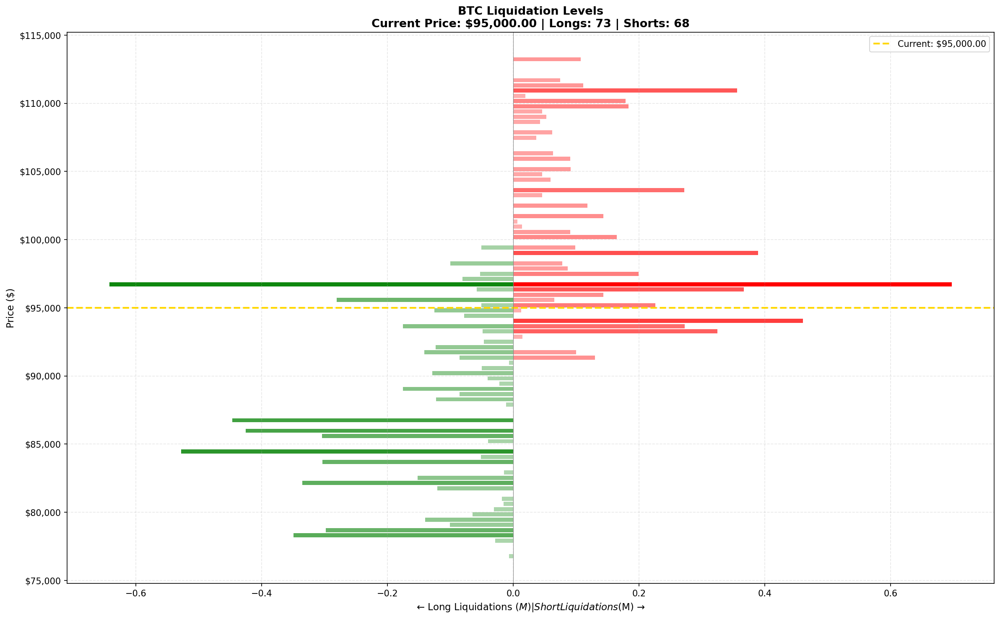

# Hyperliquid Liquidation Levels Heatmap

A Python tool for analyzing and visualizing liquidation levels on
[Hyperliquid](https://hyperliquid.xyz), a decentralized perpetual exchange. It
fetches position data, scrapes whale activity, calculates liquidation prices
and generates heatmaps that show where large liquidations are clustered.


<p align="center">
  
</p>

<p align="center">
  <em>Example: BTC liquidation levels heatmap showing where long (green) and short (red) positions would be liquidated</em>
</p>

```
                ← Long Liquidations              Short Liquidations →
                                  │
    $99,000   ─────────────      │      ██████████████████  ← Short cluster
    $98,000   ──────             │      ████████████████
    $97,000   ────               │      ██████████████
    $96,500   ──                 │      ████████
              ─────────────────────────────────────────────
    $95,000                  Current Price ($95,000)
              ─────────────────────────────────────────────
    $93,500   ████               │
    $93,000   ████████████       │
    $92,000   ████████████████   │        ← Long cluster
    $91,000   ██████████████████ │
    $90,000   ██████████         │
                                 │
```

The heatmap shows liquidation clusters in the same way the Hyperliquid trading
interface shows order book depth. **Green bars** mark where long positions are
liquidated if the price falls, **red bars** where short positions are
liquidated if the price rises. Longer bars mean more value at risk at that
price level.

## Contents

- [Features](#features)
- [How it works](#how-it-works)
- [Installation](#installation)
- [Quick start](#quick-start)
- [Usage](#usage)
- [Understanding the heatmap](#understanding-the-heatmap)
- [Architecture](#architecture)
- [Project structure](#project-structure)
- [Python API](#python-api)
- [Configuration](#configuration)
- [Data sources](#data-sources)
- [Liquidation formula](#liquidation-formula)
- [Examples](#examples)
- [Output files](#output-files)
- [Testing](#testing)
- [Troubleshooting](#troubleshooting)
- [Contributing](#contributing)
- [Disclaimer](#disclaimer)
- [License](#license)
- [Acknowledgments](#acknowledgments)

## Features

- **Real-time data**: fetches live position data from Hyperliquid's public API
- **Whale tracking**: scrapes whale trades and positions from Hypurrscan.io
- **Multi-asset support**: tracks BTC, ETH, HYPE and other perpetual markets
- **Liquidation calculation**: computes liquidation prices from leverage and margin type
- **Heatmaps**:
  - static PNG heatmaps (matplotlib)
  - interactive HTML charts (plotly)
- **Cluster detection**: identifies major liquidation clusters and key price levels
- **Terminal output**: console summary with key statistics
- **Continuous mode**: runs as a service with periodic updates
- **Demo mode**: runs on sample data without API calls

## How it works

### Liquidation basics

On Hyperliquid, traders open leveraged long or short positions. When a
position moves far enough against the trader, it is **liquidated**: the
exchange closes it to prevent negative equity.

- **Long positions** are liquidated when the price **falls** below their liquidation price.
- **Short positions** are liquidated when the price **rises** above their liquidation price.

### What the tool does

1. **Collects position data**: fetches positions from whale wallets and Hypurrscan
2. **Calculates liquidation prices**: computes where each position would be liquidated
3. **Aggregates by price level**: groups liquidations into price bins
4. **Draws the heatmap**: shows the concentration of liquidation value at each price level

### Why this matters

Large clusters of liquidations can cause **cascading effects**:

- when the price reaches a liquidation cluster, positions are closed by force
- these forced closures add selling or buying pressure
- that pressure can push the price through further liquidation levels
- the result is a "liquidation cascade" or "squeeze"

Knowing where the clusters are helps traders to:

- identify potential support and resistance levels
- anticipate volatility zones
- manage risk

## Installation

### Prerequisites

- Python 3.9 or higher
- pip

### Setup

```bash
git clone https://github.com/grzresearch/Hyperliquid-Liquidation-Levels.git
cd Hyperliquid-Liquidation-Levels

python -m venv venv
source venv/bin/activate          # Windows: venv\Scripts\activate

pip install -r requirements.txt
```

This is all that is needed to run `python main.py` from the checkout. To also
install the package and the `hyperliquid-liquidation` command:

```bash
pip install .                     # or: pip install -e ".[test]" for development
```

### Dependencies

| Package | Purpose |
|---------|---------|
| `requests` | HTTP requests to the Hyperliquid API |
| `aiohttp` | Async HTTP for concurrent fetching |
| `beautifulsoup4` | Web scraping of Hypurrscan |
| `pandas` | Data manipulation |
| `numpy` | Numerical computations |
| `matplotlib` | Static chart generation |
| `seaborn` | Enhanced visualizations |
| `plotly` | Interactive HTML charts |
| `rich` | Terminal formatting |
| `python-dotenv` | Environment configuration |

`requirements.txt` also lists optional tools such as `selenium`,
`webdriver-manager` and `kaleido`; `pyproject.toml` declares only the packages
the code imports.

## Quick start

```bash
# Demo mode (no API calls, uses sample data)
python main.py --demo

# Real data
python main.py

# Interactive HTML charts
python main.py --interactive

# Specific assets
python main.py --assets BTC ETH
```

After `pip install .`, `hyperliquid-liquidation` and
`python -m hyperliquid_liquidation` accept the same options as `python main.py`.

## Usage

### Basic usage

```bash
python main.py
```

This will:

1. fetch current prices from Hyperliquid
2. collect whale addresses from various sources
3. query the positions of those addresses
4. calculate liquidation levels
5. write heatmaps to the `output/` directory

### Demo mode

```bash
python main.py --demo
```

Generates realistic sample positions (200 per asset) to demonstrate the
visualizations without any API calls.

### Interactive charts

```bash
python main.py --interactive
# or
python main.py -i
```

Open the generated `.html` files in a browser to explore the levels with hover
details.

### Continuous monitoring

```bash
# Update every 5 minutes (default)
python main.py --continuous

# Update every minute
python main.py --continuous --interval 60

# With interactive charts
python main.py -c -i --interval 120
```

Press `Ctrl+C` to stop.

### Custom assets

```bash
# Only BTC and ETH
python main.py --assets BTC ETH

# Other Hyperliquid perpetuals
python main.py --assets BTC ETH SOL DOGE
```

### All options

```text
python main.py --help

  --demo                Run in demo mode with sample data
  --assets ASSETS ...   Assets to track (default: BTC, ETH, HYPE)
  --interactive, -i     Generate interactive HTML charts (requires plotly)
  --continuous, -c      Run continuously with periodic updates
  --interval INTERVAL   Update interval in seconds for continuous mode (default: 300)
  --output, -o OUTPUT   Output directory for generated files (default: output)
  --max-whales MAX_WHALES
                        Maximum number of whale addresses to query (default: 50)
  --testnet             Use Hyperliquid testnet instead of mainnet
```

## Understanding the heatmap

### Reading the chart

```
                    ← Long Liquidations | Short Liquidations →

$100,000  ─────────────────────────────────────────────────────
          |                              ████████  <- Short cluster
$98,000   |                         ██████████████
          |                    █████████████████████
$96,000   ─────── Current Price ─────────────────────────────
          |        █████████████
$94,000   |   █████████████████      <- Long cluster
          |  ████████████████████
$92,000   ─────────────────────────────────────────────────────
```

### Color interpretation

- **Green bars** (left side): long liquidations, triggered when the price **falls**
- **Red bars** (right side): short liquidations, triggered when the price **rises**
- **Bar length**: proportional to the USD value at risk
- **Bar intensity**: darker means more concentrated liquidations
- **Gold dashed line**: current market price

### Key metrics

| Metric | Description |
|--------|-------------|
| Total Long Value | Sum of all long position values that could be liquidated |
| Total Short Value | Sum of all short position values that could be liquidated |
| L/S Ratio | Long value / short value (>1 = more longs at risk) |
| Major Levels | Price points with the highest liquidation concentration |

## Architecture

```
┌─────────────────────────────────────────────────────────────┐
│                          main                               │
│                  (entry point and CLI)                      │
└─────────────────────┬───────────────────────────────────────┘
                      │
          ┌───────────┴───────────┐
          ▼                       ▼
┌─────────────────┐     ┌─────────────────┐
│ hyperliquid_api │     │    scraper      │
│ (API client)    │     │ (Hypurrscan)    │
└────────┬────────┘     └────────┬────────┘
         │                       │
         └───────────┬───────────┘
                     ▼
         ┌───────────────────────┐
         │ liquidation_calculator│
         │ (core calculations)   │
         └───────────┬───────────┘
                     ▼
         ┌───────────────────────┐
         │  heatmap_visualizer   │
         │ (charts and output)   │
         └───────────────────────┘
```

### Module overview

All modules live in the `hyperliquid_liquidation` package under `src/`.

| Module | Description |
|--------|-------------|
| `main.py` | `LiquidationHeatmapGenerator`, CLI parsing, orchestration |
| `config.py` | Configuration constants and settings |
| `hyperliquid_api.py` | Hyperliquid API client, position fetching |
| `scraper.py` | Web scraping of Hypurrscan whale data |
| `liquidation_calculator.py` | Liquidation price calculations, data aggregation |
| `heatmap_visualizer.py` | Matplotlib and Plotly visualizations |

## Project structure

```
Hyperliquid-Liquidation-Levels/
├── main.py                       # runs the CLI from a source checkout
├── src/
│   └── hyperliquid_liquidation/
│       ├── __init__.py
│       ├── __main__.py           # python -m hyperliquid_liquidation
│       ├── main.py
│       ├── config.py
│       ├── hyperliquid_api.py
│       ├── scraper.py
│       ├── liquidation_calculator.py
│       └── heatmap_visualizer.py
├── tests/                        # pytest smoke tests
├── assets/
│   └── heatmap_preview.png
├── .env.example
├── pyproject.toml
├── requirements.txt
└── LICENSE
```

## Python API

The package is importable after `pip install .` (or `pip install -e .`); from
a plain checkout, put `src` on `PYTHONPATH`.

### HyperliquidAPI

```python
from hyperliquid_liquidation.hyperliquid_api import HyperliquidAPI

api = HyperliquidAPI(use_testnet=False)

# All mid prices
prices = api.get_all_mids()
# {'BTC': 95000.0, 'ETH': 3500.0, ...}

# Positions of one user
positions = api.get_user_positions("0x...")
# [Position(coin='BTC', size=1.5, leverage=10, ...), ...]

# Market metadata
assets, market_data = api.get_meta_and_asset_contexts()
```

### LiquidationCalculator

```python
from hyperliquid_liquidation.liquidation_calculator import LiquidationCalculator

calc = LiquidationCalculator()

# Liquidation price of one position
liq_price = calc.calculate_position_liquidation(
    entry_price=95000,
    size=1.0,  # positive for long
    leverage=10,
    margin_type="isolated",
    coin="BTC",
)

# Aggregate positions into heatmap data
heatmap_data = calc.aggregate_positions(
    positions=positions,
    coin="BTC",
    current_price=95000,
)

# Liquidation clusters
clusters = calc.find_liquidation_clusters(heatmap_data)
```

### HeatmapVisualizer

```python
from hyperliquid_liquidation.heatmap_visualizer import HeatmapVisualizer

viz = HeatmapVisualizer()

# Static heatmap
viz.create_combined_heatmap(heatmap_data, save=True, show=True)

# Interactive chart
viz.create_interactive_heatmap(heatmap_data, save=True)

# Multi-asset dashboard
viz.create_dashboard([btc_data, eth_data, hype_data])
```

## Configuration

### Environment variables

`.env.example` lists the supported variables; copy it to `.env` to customize
them:

```bash
# API Settings
HYPERLIQUID_API_URL=https://api.hyperliquid.xyz/info
USE_TESTNET=false

# Output Settings
OUTPUT_DIR=output

# Cache Settings
CACHE_TTL=60
```

These variables are read by `get_env_config()` in `config.py`. The CLI itself
is configured through its command-line options and the dataclasses in
`config.py`.

### Configuration module

`src/hyperliquid_liquidation/config.py` holds the advanced settings, for
example in `LiquidationConfig`:

```python
# Minimum position size to consider
min_position_usd: float = 10000.0

# Whale threshold
whale_threshold_usd: float = 100000.0

# Number of price levels in the heatmap
price_levels: int = 100

# Price range (% around the current price)
price_range_percent: float = 20.0
```

## Data sources

### Hyperliquid API

The official Hyperliquid API provides:

- real-time prices (`allMids`)
- user positions (`clearinghouseState`)
- market metadata (`metaAndAssetCtxs`)

**Endpoint**: `https://api.hyperliquid.xyz/info`

**Rate limits**: about 5 requests per second recommended

### Hypurrscan.io

Hypurrscan is a third-party explorer for Hyperliquid that provides:

- whale leaderboards
- large trade history
- position tracking

**Note**: web scraping may be subject to rate limits and terms of service.

### Alternative sources

For enterprise use, consider:

- [CoinGlass API](https://www.coinglass.com/hyperliquid) - paid whale data
- [Nansen API](https://docs.nansen.ai/api/hyperliquid-apis) - on-chain analytics

## Liquidation formula

Hyperliquid uses the following formula for liquidation prices:

```
liq_price = entry_price - side × margin_available / position_size / (1 - L × side)
```

where:

- `side` = +1 for long, -1 for short
- `L` = 1 / maintenance_leverage
- `maintenance_leverage` = 2 × max_leverage

### Simplified calculations

**Isolated margin:**

```
Long:  liq_price ≈ entry × (1 - 1/leverage + maintenance_rate)
Short: liq_price ≈ entry × (1 + 1/leverage - maintenance_rate)
```

**Maintenance rates by maximum leverage:**

| Max Leverage | Maintenance Rate |
|--------------|------------------|
| 50x | 1.0% |
| 40x | 1.25% |
| 20x | 2.5% |
| 10x | 5.0% |
| 3x | 16.7% |

## Examples

### Example 1: quick analysis

```python
from hyperliquid_liquidation.main import LiquidationHeatmapGenerator

gen = LiquidationHeatmapGenerator(assets=["BTC"])
files = gen.run(demo=True)
print(f"Generated: {files}")
```

### Example 2: custom visualization

```python
from hyperliquid_liquidation.liquidation_calculator import (
    LiquidationCalculator,
    create_sample_positions,
)
from hyperliquid_liquidation.heatmap_visualizer import HeatmapVisualizer

# Sample data
positions = create_sample_positions("BTC", 95000, count=500)

# Heatmap data
calc = LiquidationCalculator()
data = calc.aggregate_positions(positions, "BTC", 95000)

# Visualize
viz = HeatmapVisualizer()
viz.create_combined_heatmap(data, show=True)
```

### Example 3: fetch real data

```python
from hyperliquid_liquidation.hyperliquid_api import HyperliquidAPI

api = HyperliquidAPI()

# Prices
prices = api.get_all_mids()
print(f"BTC: ${prices['BTC']:,.2f}")

# Positions of one address
positions = api.get_user_positions("0x...")
for pos in positions:
    print(f"{pos.coin}: {pos.size} @ ${pos.entry_price:,.2f}")
    print(f"  Liquidation: ${pos.liquidation_price:,.2f}")
```

### Example 4: WebSocket real-time updates

```python
import asyncio
from hyperliquid_liquidation.hyperliquid_api import HyperliquidWebSocket

async def on_trade(data):
    print(f"Trade: {data}")

async def main():
    ws = HyperliquidWebSocket()
    await ws.subscribe_trades("BTC", on_trade)
    await ws.listen()

asyncio.run(main())
```

## Output files

The tool writes the following files to the output directory (`output/` by
default):

| File pattern | Description |
|--------------|-------------|
| `{COIN}_combined_heatmap_{timestamp}.png` | Main heatmap |
| `{COIN}_interactive_heatmap_{timestamp}.html` | Interactive Plotly chart (`--interactive`) |
| `{COIN}_liquidation_stats_{timestamp}.json` | Summary statistics |
| `liquidation_dashboard_{timestamp}.html` | Multi-asset dashboard (`HeatmapVisualizer.create_dashboard()`) |

## Testing

```bash
pip install -r requirements.txt pytest
pytest
```

The smoke tests cover the liquidation formula, the price-level aggregation,
`main.py --help` and a demo run; they make no network calls.

## Troubleshooting

### "No positions found"

- Check network connectivity to the Hyperliquid API
- Verify that whale addresses are correct (42-character hex)
- Run with `--demo` to test the visualization

### "Rate limited"

- Reduce `--max-whales`
- Lower `rate_limit` in `LiquidationConfig`
- Consider using cached data

### Import errors

```bash
pip install --upgrade -r requirements.txt
```

### "Plotly not available"

```bash
pip install plotly kaleido
```

### Selenium errors (for JS-rendered scraping)

```bash
pip install selenium webdriver-manager
```

## Contributing

Contributions are welcome:

1. Fork the repository
2. Create a feature branch (`git checkout -b feature/amazing`)
3. Commit your changes (`git commit -m "feat: add amazing feature"`)
4. Push the branch (`git push origin feature/amazing`)
5. Open a pull request

### Development setup

```bash
git clone https://github.com/grzresearch/Hyperliquid-Liquidation-Levels.git
cd Hyperliquid-Liquidation-Levels
python -m venv venv
source venv/bin/activate
pip install -r requirements.txt
pip install -e ".[test]"
pytest
```

## Disclaimer

**This tool is for educational and informational purposes only.**

- Not financial advice
- No guarantees of accuracy
- Use at your own risk
- Respect API rate limits and terms of service
- Past liquidation patterns do not predict future movements

The authors are not responsible for any financial losses incurred from using
this tool or acting on its output.

## License

MIT License - see [LICENSE](LICENSE) for details.

## Acknowledgments

- [Hyperliquid](https://hyperliquid.xyz) - decentralized perpetual exchange
- [Hypurrscan](https://hypurrscan.io) - Hyperliquid explorer
- [CoinGlass](https://coinglass.com) - crypto derivatives data

For questions or support, please
[open an issue](https://github.com/grzresearch/Hyperliquid-Liquidation-Levels/issues).
